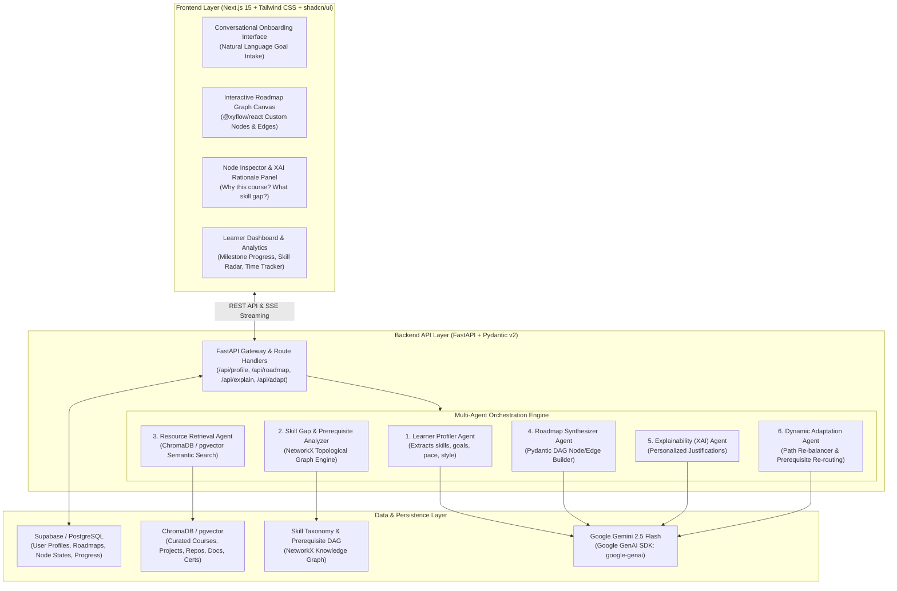
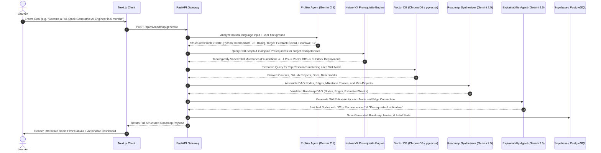
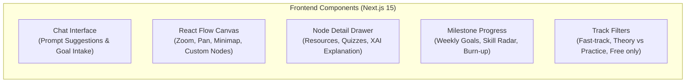
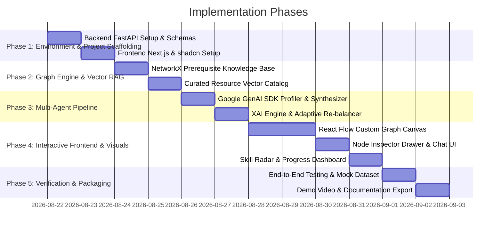

# AI-Powered Personalized Learning Path Recommender
## Technical Architecture, System Design & End-to-End Implementation Blueprint

---

## 1. System Architecture Overview

The system is designed with a modern decoupled architecture separating the **Intelligent Agent Backend (FastAPI + NetworkX + Google GenAI SDK)** from the **Interactive Client Application (Next.js + React Flow + shadcn/ui)**.



---

## 2. Technology Stack & Architectural Rationale

| Layer | Selected Technology | Version / Spec | Key Architectural Rationale |
| :--- | :--- | :--- | :--- |
| **Frontend & UI** | **Next.js (App Router)** + **TypeScript** | Next.js 15+ / React 19 | High-performance server rendering, robust typing, seamless API integration, dynamic client-side hydration. |
| **Styling & Components** | **Tailwind CSS** + **shadcn/ui** | Tailwind v3.4+, Radix UI | Fast, beautiful accessible components (Modals, Drawers, Cards, Badges, Tabs, Tooltips) with custom dark/light theme. |
| **Graph Visualization** | **React Flow** (`@xyflow/react`) | @xyflow/react v12+ | Renders interactive, zoomable, draggable node graphs with custom status styles (locked, unlocked, completed, milestone badges). |
| **Visual Charts** | **Recharts** / **Lucide React** | Latest | Radar charts for skill gap analysis, progress burn-up charts, modern icon set. |
| **Backend Framework** | **FastAPI** | Python 3.11+ | Ultra-fast async execution, automatic OpenAPI/Swagger docs, strict Pydantic v2 data validation for deterministic JSON schemas. |
| **LLM & Agent Engine** | **Google GenAI SDK (`google-genai`)** | `google-genai` (Gemini 2.5 Flash) | High throughput, 1M+ context window, ultra-low latency, native structured JSON output mode via Pydantic schemas. |
| **Prerequisite Graph Engine** | **NetworkX** | Python 3.11+ | Strict Directed Acyclic Graph (DAG) construction, cycle prevention (`nx.is_directed_acyclic_graph`), topological sorting, and critical path calculation. |
| **Vector Database & RAG** | **ChromaDB** / **pgvector** | Local Chroma / Supabase pgvector | Stores vector embeddings of 500+ curated courses, GitHub project repositories, freeCodeCamp modules, and official docs. |
| **Database & Auth** | **Supabase (PostgreSQL)** | PostgreSQL 16+ | Handles user authentication, profile states, roadmap persistence, user node completion states, and progress analytics. |

---

## 3. Multi-Agent Pipeline & Workflow Details



### Agent 1: Learner Profiling Agent
- **Input:** Natural language user intent, past experience, completed topics, weekly hours, learning medium preferences (video, text, project-based).
- **Core Function:** Extracts normalized skill levels (Novice, Beginner, Intermediate, Advanced), available timeline, target domain, and constraints.
- **Output:** Validated `LearnerProfile` Pydantic model.

### Agent 2: Skill Gap & Prerequisite Graph Engine (`NetworkX`)
- **Knowledge Base:** Internal skill taxonomy graph (e.g., Python Basics $\rightarrow$ Object-Oriented Programming $\rightarrow$ PyTorch Fundamentals $\rightarrow$ Transformer Architecture $\rightarrow$ Fine-Tuning LoRA $\rightarrow$ Quantization & vLLM Serving).
- **Graph Algorithms:**
  - `nx.DiGraph()`: Builds skill dependency graph.
  - `nx.topological_sort()`: Determines mathematically valid prerequisite ordering.
  - `nx.ancestors()`: Identifies all mandatory foundational nodes for any target skill.
  - `nx.is_directed_acyclic_graph()`: Verifies that no circular dependency exists.
- **Output:** Ordered sequence of skill competencies filtered by learner's existing skills (eliminating redundant prerequisites).

### Agent 3: Hybrid Semantic Resource Retriever (RAG)
- **Data Catalog:** Curated database containing structured metadata:
  - Course Title, Provider (Coursera, DeepLearning.AI, fast.ai, YouTube, MIT OCW, Harvard CS50).
  - Practical Repositories (GitHub projects, real-world starter kits).
  - Difficulty Level (Beginner, Intermediate, Advanced).
  - Format (Interactive Code, Video, Documentation, Capstone Project).
  - Estimated Duration (Hours).
- **Embeddings & Search:** Vector embeddings generated and queried via cosine similarity with metadata filtering (`difficulty <= user_level_cap`, `rating >= 4.5`, `cost == 'free' | 'freemium'`).

### Agent 4: Roadmap Synthesizer Agent
- **LLM Engine:** Gemini 2.5 Flash with structured output schema.
- **Function:** Combines skill milestones, retrieved resources, and practical projects into a multi-tiered DAG layout with coordinate positioning for React Flow (`x`, `y` coordinates, phase grouping, locked/unlocked initial states).

### Agent 5: Explainability (XAI) Agent
- **Function:** For every node in the roadmap, generates:
  - `why_recommended`: Direct connection between learner's goal and this specific resource.
  - `prerequisites_addressed`: What prior knowledge this builds on.
  - `expected_outcome`: What tangible skill or project artifact the learner will possess after completion.
  - `estimated_effort`: Weekly hours required.

### Agent 6: Dynamic Adaptation & Re-balancer Agent
- **Trigger:** Learner marks a node as completed, rates a milestone as "Too Easy" / "Too Hard", or completes a skill quiz.
- **Function:** Dynamically unlocks downstream dependent nodes, offers acceleration fast-tracks (skipping redundant nodes), or inserts remediation resources.

---

## 4. Data Models & Pydantic Schemas

```python
from pydantic import BaseModel, Field
from typing import List, Optional, Literal
from enum import Enum

class SkillLevel(str, Enum):
    BEGINNER = "beginner"
    INTERMEDIATE = "intermediate"
    ADVANCED = "advanced"

class ResourceType(str, Enum):
    COURSE = "course"
    PROJECT = "project"
    DOCUMENTATION = "documentation"
    VIDEO = "video"
    CERTIFICATION = "certification"

class LearningResource(BaseModel):
    id: str
    title: str
    provider: str
    url: str
    type: ResourceType
    estimated_hours: int
    cost: Literal["free", "paid", "freemium"]
    rating: float = 4.8
    skills_covered: List[str]

class NodeStatus(str, Enum):
    LOCKED = "locked"
    AVAILABLE = "available"
    IN_PROGRESS = "in_progress"
    COMPLETED = "completed"

class RoadmapNodeData(BaseModel):
    label: str
    phase: int
    phase_title: str
    description: str
    status: NodeStatus = NodeStatus.LOCKED
    primary_resource: LearningResource
    alternative_resources: List[LearningResource] = []
    practical_project: Optional[str] = None
    why_recommended: str
    skills_acquired: List[str]
    estimated_weeks: int
    difficulty: SkillLevel

class RoadmapNode(BaseModel):
    id: str
    type: str = "customMilestoneNode"
    position: dict # {"x": float, "y": float}
    data: RoadmapNodeData

class RoadmapEdge(BaseModel):
    id: str
    source: str
    target: str
    animated: bool = False
    style: Optional[dict] = None
    label: Optional[str] = None

class RoadmapResponse(BaseModel):
    roadmap_id: str
    title: str
    target_role: str
    total_estimated_weeks: int
    total_hours: int
    learner_summary: str
    skill_gap_summary: List[str]
    nodes: List[RoadmapNode]
    edges: List[RoadmapEdge]
```

---

## 5. Frontend & UI/UX Architecture



### Key UI Features
1. **Interactive Node Graph (`@xyflow/react`):**
   - Color-coded node statuses (Emerald for Completed, Indigo for In-Progress, Amber for Available, Slate for Locked).
   - Dynamic bezier curved edges with glowing animated pulses for active learning paths.
   - Minimap, zoom controls, fit-view button, and track filtering.
2. **Node Inspector & XAI Modal / Drawer:**
   - Displays resource cards with direct links, provider badges, video durations, and GitHub repository links.
   - Prominent **"Why this is recommended"** card breaking down the AI rationale.
   - Milestone checklist with interactive checkboxes and self-assessment quizzes.
3. **Skill Gap & Progress Dashboard:**
   - Interactive Radar Chart comparing **Initial Baseline Skills** vs **Target Goal Mastery**.
   - Time commitment tracker (e.g. *8 / 12 hours completed this week*).
4. **Adaptive Re-routing Action:**
   - *"I already know this"* button $\rightarrow$ dynamically triggers backend graph re-calculation and unlocks next nodes.
   - *"Need more practice"* button $\rightarrow$ injects intermediate coding challenges and supplementary exercises.

---

## 6. Gemini 2.5 Flash SDK Integration Pattern

Following the project's standard guidelines, the integration uses the modern `google-genai` library:

```python
import os
from google import genai
from google.genai import types

# Initializing Google GenAI Client
# Automatically reads GEMINI_API_KEY from the environment
client = genai.Client()

async def generate_structured_learning_plan(prompt: str, response_schema):
    """
    Generates a strictly validated structured JSON response using Gemini 2.5 Flash
    """
    response = client.models.generate_content(
        model="gemini-2.5-flash",
        contents=prompt,
        config=types.GenerateContentConfig(
            response_mime_type="application/json",
            response_schema=response_schema,
            temperature=0.2, # Low temperature for reliable graph structure
            system_instruction=(
                "You are an elite AI Curriculum Architect and Career Mentor. "
                "Your task is to analyze the learner's skill gap, structure a topologically "
                "valid prerequisite learning path, curate high-impact resources, and explain "
                "every single recommendation with clear XAI reasoning."
            ),
        ),
    )
    return response.text
```

---

## 7. Step-by-Step Implementation Roadmap



### Detailed Phase Milestones
- **Phase 1: Project Scaffolding & Foundation**
  - Initialize Next.js 15 app with Tailwind CSS, shadcn/ui components (`button`, `card`, `dialog`, `drawer`, `tabs`, `badge`, `progress`, `tooltip`).
  - Initialize FastAPI backend with CORS, Pydantic v2 schemas, and health check endpoints.
- **Phase 2: Prerequisite Knowledge Graph & RAG Catalog**
  - Implement `SkillGraphManager` using `NetworkX` with curated skill taxonomies (AI/ML Engineering, Full-Stack Web Development, Data Engineering, Cloud DevOps, Cybersecurity).
  - Create embedded vector database (ChromaDB / in-memory vector store) with 500+ verified courses, projects, and certifications.
- **Phase 3: Multi-Agent AI Core (`google-genai` + Gemini 2.5 Flash)**
  - Implement `ProfilerAgent` extracting goals, skills, time, and pace.
  - Implement `RoadmapSynthesizerAgent` generating DAG nodes, edges, and milestones.
  - Implement `ExplainabilityAgent` generating transparent justification strings.
  - Implement `AdaptationAgent` enabling instant re-routing when nodes are completed or skipped.
- **Phase 4: Frontend Visualization & Interactive Experience**
  - Build conversational chat onboarding with preset goal templates (*"Become an LLM Engineer"*, *"Transition from Junior to Senior Full-Stack"*, etc.).
  - Implement React Flow interactive canvas with custom nodes, animated connecting edges, status transitions, and zoom/pan controls.
  - Build node detail slide-over drawer with direct resource links, milestone checklist, and XAI rationale breakdown.
  - Build Learner Progress Dashboard with Recharts skill radar and weekly study tracker.
- **Phase 5: Evaluation, Polish & Deliverables**
  - Automated tests for DAG cycle detection and topological sorting validity.
  - Comprehensive documentation, clean repo structure, demo video recording scripts, and ZIP distribution package.
