# AI-Powered Personalized Learning Path Recommender
## Chronological Component Implementation Guide & Build Order

---

## Overview

This document specifies the **exact step-by-step chronological order** for building the entire system. Every component is listed with its target file location, architectural purpose, detailed implementation logic, prerequisites, and verification criteria.

```mermaid
flowchart TD
    subgraph Phase1["Phase 1: Foundations & Schemas"]
        S1["Step 1: Backend Scaffolding\n(backend/requirements.txt, .env)"] --> S2["Step 2: Pydantic Data Contracts\n(backend/models/schemas.py)"]
    end

    subgraph Phase2["Phase 2: Graph Engine & Knowledge Catalog"]
        S2 --> S3["Step 3: NetworkX DAG Prerequisite Engine\n(backend/services/graph_engine.py)"]
        S3 --> S4["Step 4: Curated Resource Catalog & RAG\n(backend/services/rag_service.py)"]
    end

    subgraph Phase3["Phase 3: AI Multi-Agent Core (Gemini 2.5 Flash)"]
        S4 --> S5["Step 5: LLM Client Wrapper\n(backend/services/llm_client.py)"]
        S5 --> S6["Step 6: Profiler Agent\n(backend/agents/profiler_agent.py)"]
        S6 --> S7["Step 7: Roadmap Synthesizer Agent\n(backend/agents/roadmap_agent.py)"]
        S7 --> S8["Step 8: Explainability (XAI) Agent\n(backend/agents/xai_agent.py)"]
        S8 --> S9["Step 9: Path Adaptation Agent\n(backend/agents/adaptation_agent.py)"]
    end

    subgraph Phase4["Phase 4: Backend API Gateway"]
        S9 --> S10["Step 10: FastAPI Routes & Server\n(backend/main.py, routers/)"]
    end

    subgraph Phase5["Phase 5: Frontend & UI Design System"]
        S10 --> S11["Step 11: Next.js 15 + Tailwind + shadcn\n(frontend/ scaffolding)"]
        S11 --> S12["Step 12: API Client & State Store\n(frontend/lib/api.ts, store/)"]
        S12 --> S13["Step 13: React Flow Canvas & Custom Nodes\n(frontend/components/roadmap/)"]
        S13 --> S14["Step 14: Node Inspector & XAI Drawer\n(frontend/components/roadmap/NodeInspectorDrawer.tsx)"]
        S14 --> S15["Step 15: Conversational Goal Intake\n(frontend/components/chat/GoalChat.tsx)"]
        S15 --> S16["Step 16: Learner Analytics & Radar Chart\n(frontend/components/dashboard/LearnerDashboard.tsx)"]
    end

    subgraph Phase6["Phase 6: Integration, Polish & Submission"]
        S16 --> S17["Step 17: Dynamic Adaptation Loop\n(End-to-End Path Re-routing)"]
        S17 --> S18["Step 18: Automated Test Suite\n(backend/tests/)"]
        S18 --> S19["Step 19: Deliverables Packaging\n(Source ZIP, Video Script, Docs)"]
    end
```



---

## Detailed Chronological Build Order

---

### Step 1: Backend Environment & Project Foundation
- **Target File:** `backend/requirements.txt`, `backend/.env.example`, `backend/.gitignore`
- **Order:** **1st**
- **Prerequisites:** None
- **Purpose:** Establish the Python 3.11+ virtual environment, install required libraries, and manage environment secrets.
- **Implementation Details:**
  - `requirements.txt`:
    ```txt
    fastapi>=0.115.0
    uvicorn[standard]>=0.30.0
    pydantic>=2.8.0
    networkx>=3.3
    google-genai>=0.1.1
    chromadb>=0.5.0
    python-dotenv>=1.0.1
    pytest>=8.2.0
    httpx>=0.27.0
    ```
  - `.env.example`: Specify `GEMINI_API_KEY`, `PORT=8000`, `ENVIRONMENT=development`.
- **Verification:** Run `pip install -r requirements.txt` and ensure clean dependency resolution without conflicts.

---

### Step 2: Data Models & Pydantic Schemas (The System Contract)
- **Target File:** `backend/models/schemas.py`
- **Order:** **2nd**
- **Prerequisites:** Step 1
- **Purpose:** Define strict data types and JSON schemas shared across all agents, algorithms, and API endpoints.
- **Implementation Details:**
  - `LearnerProfile`: Target role, current skills with proficiency levels (`beginner`, `intermediate`, `advanced`), weekly hours, learning pace, preferred mediums (video/code/reading).
  - `LearningResource`: Title, provider (Coursera, fast.ai, YouTube, GitHub, docs), URL, type, estimated hours, rating, cost type (`free`, `paid`, `freemium`).
  - `RoadmapNodeData`: Milestone title, phase index, description, status (`locked`, `available`, `in_progress`, `completed`), primary resource, alternatives, mini-project, `why_recommended` (XAI), skills acquired.
  - `RoadmapNode`: Standard React Flow node format (`id`, `type="customMilestone"`, `position: {x, y}`, `data: RoadmapNodeData`).
  - `RoadmapEdge`: Standard React Flow edge format (`id`, `source`, `target`, `animated`, `style`).
  - `RoadmapResponse`: Complete payload including summary, skill gap breakdown, nodes array, and edges array.
  - `AdaptationRequest` & `AdaptationResponse`: Payloads for node completion and dynamic re-routing.
- **Verification:** Write a schema test script verifying instant serialization/deserialization to and from JSON.

---

### Step 3: Skill Taxonomy & NetworkX Prerequisite Graph Engine
- **Target Files:** `backend/data/skill_taxonomy.json`, `backend/services/graph_engine.py`
- **Order:** **3rd**
- **Prerequisites:** Step 2
- **Purpose:** Build the deterministic mathematical backbone that guarantees prerequisites are topologically ordered with zero circular dependencies.
- **Implementation Details:**
  - `skill_taxonomy.json`: Comprehensive graph data covering AI/ML, Full-Stack Development, Data Engineering, and DevOps (e.g., `Python -> Linear Algebra -> PyTorch -> Transformer Attention -> LoRA Fine-Tuning -> vLLM Deployment`).
  - `SkillGraphEngine` Class:
    - `build_graph()`: Constructs a `networkx.DiGraph()` from taxonomy edges.
    - `verify_acyclic()`: Ensures `nx.is_directed_acyclic_graph(G)` is `True`.
    - `get_prerequisite_chain(target_skills)`: Extracts `nx.ancestors()` to find all non-negotiable fundamentals.
    - `topological_sort(subgraph)`: Returns the mathematically valid sequence of milestones.
    - `calculate_node_coordinates(nodes, edges)`: Calculates grid `(x, y)` positions partitioned by milestone phase for fluid React Flow rendering.
- **Verification:** Unit test asserting that advanced nodes (e.g., *Fine-Tuning LoRA*) never appear before foundational nodes (e.g., *PyTorch Basics*).

---

### Step 4: Curated Resource Knowledge Base & RAG Search Service
- **Target Files:** `backend/data/curated_resources.json`, `backend/services/rag_service.py`
- **Order:** **4th**
- **Prerequisites:** Step 2
- **Purpose:** Provide high-quality, verified learning resources (courses, GitHub starter kits, papers, official documentation) mapped to taxonomy skills.
- **Implementation Details:**
  - `curated_resources.json`: 500+ curated items from top providers (DeepLearning.AI, Harvard CS50, fast.ai, MIT OCW, freeCodeCamp, HuggingFace, PyTorch Docs).
  - `RAGService` Class:
    - Loads curated catalog into memory / vector search index.
    - `find_best_resources(skill_name, difficulty, resource_type)`: Performs filtered keyword + semantic ranking.
    - Enriches every roadmap node with verified URLs, difficulty tags, and estimated time allocations.
- **Verification:** Query search for `"transformer attention"` and verify top result returns high-quality courses (e.g., *Stanford CS25* or *Hugging Face NLP Course*).

---

### Step 5: Google GenAI SDK Client Wrapper (Gemini 2.5 Flash)
- **Target File:** `backend/services/llm_client.py`
- **Order:** **5th**
- **Prerequisites:** Step 1, Step 2
- **Purpose:** Provide a centralized, fault-tolerant interface for all agent queries using the `google-genai` Python library with structured JSON output enforcement.
- **Implementation Details:**
  - Uses `from google import genai` and `from google.genai import types`.
  - Initializes `client = genai.Client()` (picks up `GEMINI_API_KEY` from environment).
  - `generate_structured_output(prompt, response_schema, system_instruction)`: Calls `client.models.generate_content()` with `model="gemini-2.5-flash"` and `response_mime_type="application/json"`.
  - Implements automatic retry with exponential backoff for rate limits.
- **Verification:** Send a test prompt to Gemini 2.5 Flash and verify strict Pydantic JSON parsing.

---

### Step 6: Profiler Agent
- **Target File:** `backend/agents/profiler_agent.py`
- **Order:** **6th**
- **Prerequisites:** Step 2, Step 5
- **Purpose:** Analyze natural language user input and extract structured learner competencies, target roles, constraints, and preferences.
- **Implementation Details:**
  - Prompt Engineering: Instructs Gemini 2.5 Flash to act as an expert technical career counselor.
  - Normalizes user skill mentions (e.g., "coded a few Python scripts" $\rightarrow$ `python: beginner`).
  - Outputs structured `LearnerProfile` object.
- **Verification:** Pass `"I know basic JavaScript and HTML, want to build fullstack AI apps in 3 months with 10h/week"` and verify output profile parameters.

---

### Step 7: Roadmap Synthesizer Agent
- **Target File:** `backend/agents/roadmap_agent.py`
- **Order:** **7th**
- **Prerequisites:** Step 2, Step 3, Step 4, Step 5, Step 6
- **Purpose:** Merge the learner profile, NetworkX topological prerequisite sequence, and RAG-retrieved resources into a complete multi-phase roadmap graph.
- **Implementation Details:**
  - Constructs 4 to 6 logical learning phases (e.g., *Phase 1: Foundations*, *Phase 2: Core Engineering*, *Phase 3: Applied Systems*, *Phase 4: Capstone Portfolio*).
  - Assigns hands-on project deliverables for each milestone (e.g., *"Build a Multi-Document RAG Bot with LangChain & FAISS"*).
  - Formats nodes and edges directly for React Flow consumption.
- **Verification:** Generate a full roadmap and verify that every node has valid phase indices, prerequisites, and resource objects.

---

### Step 8: Explainability (XAI) Agent
- **Target File:** `backend/agents/xai_agent.py`
- **Order:** **8th**
- **Prerequisites:** Step 2, Step 5, Step 7
- **Purpose:** Generate transparent, learner-specific rationales for every recommendation, satisfying the XAI evaluation criteria.
- **Implementation Details:**
  - Explains:
    1. *Why this milestone is recommended for this specific learner.*
    2. *How it addresses their current skill gap.*
    3. *What tangible outcome they achieve upon completion.*
  - Appends `why_recommended` justifications into each node's `data` payload.
- **Verification:** Inspect generated node data to ensure rationales are personalized rather than generic templates.

---

### Step 9: Dynamic Path Adaptation Agent
- **Target File:** `backend/agents/adaptation_agent.py`
- **Order:** **9th**
- **Prerequisites:** Step 2, Step 3, Step 5, Step 7
- **Purpose:** Dynamically adjust the roadmap when a learner marks a node as completed, skips a concept, or requests supplementary practice.
- **Implementation Details:**
  - Checks downstream dependencies in the NetworkX graph.
  - If all parent nodes of a locked node are `completed`, unlocks the node (`status = "available"`).
  - If learner clicks *"I already know this"*, marks node completed and re-balances estimated completion time.
  - If learner clicks *"Need more practice"*, injects an intermediate challenge sub-node.
- **Verification:** Simulate completing Node 1 and assert that Node 2 status dynamically updates from `locked` to `available`.

---

### Step 10: FastAPI Application Gateway & REST Endpoints
- **Target Files:** `backend/main.py`, `backend/routers/roadmap_routes.py`
- **Order:** **10th**
- **Prerequisites:** Steps 1 through 9
- **Purpose:** Expose high-performance async API endpoints connecting frontend requests to the agent pipeline.
- **Implementation Details:**
  - CORS Middleware: Configured for `http://localhost:3000` and production domains.
  - Endpoints:
    - `POST /api/v1/profile/extract`: Extracts learner profile from conversational text.
    - `POST /api/v1/roadmap/generate`: Generates complete DAG roadmap with XAI explanations.
    - `POST /api/v1/roadmap/adapt`: Re-computes path upon node completion / feedback.
    - `GET /api/v1/health`: Returns service status and Gemini API connectivity.
- **Verification:** Run `uvicorn backend.main:app --reload` and execute test requests via Swagger UI (`http://localhost:8000/docs`).

---

### Step 11: Frontend Next.js Project & UI Design System Setup
- **Target Files:** `frontend/package.json`, `frontend/tailwind.config.js`, `frontend/components/ui/`
- **Order:** **11th**
- **Prerequisites:** Node.js v18+
- **Purpose:** Initialize Next.js 15 App Router project with Tailwind CSS, shadcn/ui components, and Lucide icons for a stunning aesthetic.
- **Implementation Details:**
  - Install dependencies: `@xyflow/react`, `lucide-react`, `recharts`, `framer-motion`, `clsx`, `tailwind-merge`.
  - Configure shadcn/ui component primitives: `Button`, `Card`, `Dialog`, `Drawer`, `Badge`, `Progress`, `Tabs`, `Tooltip`, `Separator`.
  - Set up sleek Dark/Light mode theme with glassmorphic accents.
- **Verification:** Run `npm run dev` and confirm server is running at `http://localhost:3000` with clean UI styling.

---

### Step 12: API Client & State Management
- **Target Files:** `frontend/lib/api.ts`, `frontend/lib/types.ts`, `frontend/store/roadmapStore.ts`
- **Order:** **12th**
- **Prerequisites:** Step 2, Step 10, Step 11
- **Purpose:** Provide typed client-side fetch methods and global reactive state management (Zustand) for the roadmap and active learner profile.
- **Implementation Details:**
  - `types.ts`: Mirrored TypeScript interfaces matching Pydantic backend models.
  - `api.ts`: Typed fetch wrappers for roadmap generation, adaptation, and search.
  - `roadmapStore.ts`: Manages active roadmap, selected node, filtering state, loading states, and chat history.
- **Verification:** Test API client mock calls and verify TypeScript compilation without errors.

---

### Step 13: Interactive React Flow Roadmap Canvas
- **Target Files:** `frontend/components/roadmap/RoadmapCanvas.tsx`, `frontend/components/roadmap/MilestoneNode.tsx`, `frontend/components/roadmap/PrerequisiteEdge.tsx`
- **Order:** **13th**
- **Prerequisites:** Step 11, Step 12
- **Purpose:** The visual cornerstone of the project: an interactive node graph rendering milestones, prerequisites, progress badges, and branching specializations.
- **Implementation Details:**
  - `@xyflow/react` integration with custom node types:
    - `MilestoneNode`: Renders phase tag, title, estimated hours, difficulty badge, status indicator (Emerald for Completed, Indigo for In-Progress, Amber for Available, Slate for Locked).
    - `PrerequisiteEdge`: Custom bezier curves with animated glowing pulse effects for active paths.
  - Controls: Zoom in/out, Pan, Fit-View, Minimap, and Phase Filter chips.
- **Verification:** Render a sample 6-node DAG graph in the browser and test dragging, zooming, and node click selection.

---

### Step 14: Node Inspector & XAI Rationale Drawer
- **Target File:** `frontend/components/roadmap/NodeInspectorDrawer.tsx`
- **Order:** **14th**
- **Prerequisites:** Step 12, Step 13
- **Purpose:** Slide-over detail panel opening when a node is clicked, showing curated courses, project instructions, and the AI explanation.
- **Implementation Details:**
  - Displays primary and alternative resource cards with direct launch buttons.
  - Highlights **"Why AI Recommended This"** card with clear skill gap justification.
  - Practical capstone project specifications with clear milestone deliverables.
  - Action buttons: *"Mark as Completed"*, *"Fast-track / Skip"*, *"Ask AI Tutor for Help"*.
- **Verification:** Click a milestone node on the canvas and verify that the drawer slides in smoothly with complete details.

---

### Step 15: Conversational Goal Intake & Quick-Start Wizard
- **Target File:** `frontend/components/chat/GoalChat.tsx`
- **Order:** **15th**
- **Prerequisites:** Step 11, Step 12
- **Purpose:** Welcoming conversational interface where users describe their aspirations in natural language.
- **Implementation Details:**
  - Quick-start prompt chips (e.g., *"LLM Application Engineer"*, *"Full-Stack AI Developer"*, *"Zero to Hero Data Engineer"*).
  - Multi-turn refinement input (allows adding available hours/week, existing skills).
  - Engaging loading state with animated progress steps (*"Analyzing profile..."*, *"Validating prerequisites..."*, *"Curating top courses..."*, *"Building interactive graph..."*).
- **Verification:** Submit a prompt from the chat UI and verify that it triggers roadmap generation and auto-transitions to the canvas.

---

### Step 16: Learner Analytics Dashboard & Skill Gap Radar
- **Target File:** `frontend/components/dashboard/LearnerDashboard.tsx`
- **Order:** **16th**
- **Prerequisites:** Step 11, Step 12
- **Purpose:** Visually summarize the learner's journey, weekly time commitment, and competency growth.
- **Implementation Details:**
  - Recharts Radar Chart: Visualizes **Baseline Proficiency** vs **Target Goal Mastery** across core skill dimensions.
  - Weekly study time tracker (e.g., *8 / 12 hours completed this week*).
  - Overall path completion percentage bar.
- **Verification:** Verify that the radar chart dynamically scales based on the active roadmap's skill attributes.

---

### Step 17: Dynamic Adaptation Loop & Interactive Actions
- **Target Files:** `frontend/components/roadmap/AdaptationControls.tsx`, `frontend/components/chat/AIAssistantChat.tsx`
- **Order:** **17th**
- **Prerequisites:** Steps 9, 10, 13, 14
- **Purpose:** Complete the interactive feedback loop, allowing real-time path updates and in-context AI mentoring.
- **Implementation Details:**
  - Connects "Mark as Completed" button to the `/api/v1/roadmap/adapt` backend endpoint.
  - Downstream nodes unlock with smooth color transitions and animated edge pulses.
  - In-canvas AI Assistant modal for asking contextual questions (*"Can you give me a coding exercise for this milestone?"*).
- **Verification:** Mark Milestone 1 complete $\rightarrow$ confirm Milestone 2 immediately transitions from locked to unlocked without page reload.

---

### Step 18: Automated Verification & Test Suite
- **Target Files:** `backend/tests/test_graph_engine.py`, `backend/tests/test_api.py`, `backend/tests/test_agents.py`
- **Order:** **18th**
- **Prerequisites:** Steps 1 through 17
- **Purpose:** Ensure 100% code quality, zero runtime crashes, and mathematically guaranteed DAG properties.
- **Implementation Details:**
  - `test_graph_engine.py`: Tests DAG acyclicity, topological sort correctness, and coordinate calculation.
  - `test_api.py`: Tests HTTP 200 responses, schema validation, and error boundaries.
  - `test_agents.py`: Tests structured JSON generation with mock and live Gemini 2.5 Flash calls.
- **Verification:** Run `pytest backend/tests/` and verify all tests pass.

---

### Step 19: Submission Deliverables & Packaging
- **Target Files:** `README.md`, `run_app.bat`, `run_app.sh`, `DEMO_SCRIPT.md`, `submission_bundle.zip`
- **Order:** **19th (Final)**
- **Prerequisites:** All prior steps completed
- **Purpose:** Package all 5 official deliverables required by the submission guidelines.
- **Implementation Details:**
  - Complete `README.md` with one-click setup commands (`run_app.bat` for Windows / `run_app.sh` for Mac/Linux).
  - `DEMO_SCRIPT.md`: Step-by-step 3–5 minute video recording script showcasing key features.
  - Clean Source Code ZIP archive excluding `node_modules`, `.venv`, and temporary cache files.
- **Verification:** Extract ZIP into a clean temporary directory and verify seamless local startup.

---

## Summary Matrix

| Step # | Layer | Component / File | Core Responsibility | Status |
| :---: | :--- | :--- | :--- | :---: |
| **1** | Backend | `backend/requirements.txt`, `.env` | Environment setup & dependencies | ⚪ Pending |
| **2** | Backend | `backend/models/schemas.py` | Strict Pydantic v2 data models | ⚪ Pending |
| **3** | Backend | `backend/services/graph_engine.py` | NetworkX DAG prerequisite sequencing | ⚪ Pending |
| **4** | Backend | `backend/services/rag_service.py` | Curated course & project catalog RAG | ⚪ Pending |
| **5** | Backend | `backend/services/llm_client.py` | Google GenAI SDK (Gemini 2.5 Flash) | ⚪ Pending |
| **6** | Backend | `backend/agents/profiler_agent.py` | Natural language profile extraction | ⚪ Pending |
| **7** | Backend | `backend/agents/roadmap_agent.py` | Multi-phase roadmap graph synthesis | ⚪ Pending |
| **8** | Backend | `backend/agents/xai_agent.py` | Explainable AI ($XAI$) justification | ⚪ Pending |
| **9** | Backend | `backend/agents/adaptation_agent.py` | Dynamic path re-balancing & unlocks | ⚪ Pending |
| **10** | Backend | `backend/main.py`, `routers/` | FastAPI REST & SSE endpoints | ⚪ Pending |
| **11** | Frontend | `frontend/` (Next.js 15, Tailwind, shadcn) | UI design system & responsive layout | ⚪ Pending |
| **12** | Frontend | `frontend/lib/api.ts`, `store/` | Typed API client & state management | ⚪ Pending |
| **13** | Frontend | `frontend/components/roadmap/` | React Flow interactive graph canvas | ⚪ Pending |
| **14** | Frontend | `frontend/components/roadmap/NodeInspectorDrawer.tsx` | Slide-over resource & XAI drawer | ⚪ Pending |
| **15** | Frontend | `frontend/components/chat/GoalChat.tsx` | Conversational goal intake wizard | ⚪ Pending |
| **16** | Frontend | `frontend/components/dashboard/LearnerDashboard.tsx` | Skill gap radar & progress analytics | ⚪ Pending |
| **17** | Frontend | `frontend/components/roadmap/AdaptationControls.tsx` | Real-time path re-routing loop | ⚪ Pending |
| **18** | Quality | `backend/tests/` | Automated unit & integration tests | ⚪ Pending |
| **19** | Release | `README.md`, `run_app.bat`, ZIP package | Final documentation, demo & bundle | ⚪ Pending |
