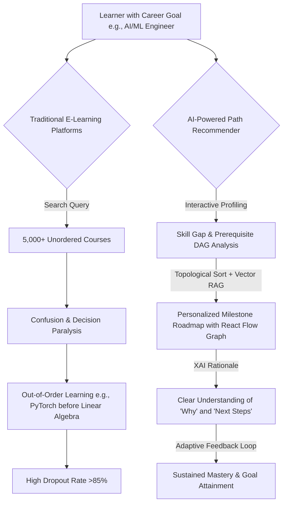

# AI-Powered Personalized Learning Path Recommender
## Comprehensive Problem Statement, Objectives & Evaluation Framework

---

## 1. Executive Summary & Context

The digital learning landscape is experiencing exponential growth, with hundreds of thousands of online courses, tutorials, open-source repositories, and certification programs available across platforms like Coursera, edX, MIT OpenCourseWare, YouTube, Udemy, and fast.ai. However, this abundance has triggered a **"Choice Overload & Sequencing Paradox"**:

> *Learners do not suffer from a lack of learning resources; they suffer from the cognitive overload of selecting, validating, and properly sequencing resources that align precisely with their unique starting points, time constraints, learning styles, and career goals.*

Traditional recommendation systems in e-learning platforms operate on rudimentary collaborative filtering ("users who took Course A also took Course B") or static keyword matching. These legacy approaches fail in four fundamental dimensions:
1. **Lack of Dynamic Sequencing & Prerequisite Awareness:** They recommend disjointed lists of individual courses rather than a structured, topologically ordered dependency path (Directed Acyclic Graph).
2. **One-Size-Fits-All Rigidity:** They ignore prior knowledge, skill gaps, available weekly hours, and target depth (e.g., theoretical mastery vs. practical engineering).
3. **Black-Box "Cold" Recommendations:** They provide no explainability ($XAI$) explaining *why* a particular milestone is necessary and *how* it connects to the learner's terminal goal.
4. **Static, Non-Adaptive Roadmaps:** They cannot dynamically adapt when a learner struggles with a concept, completes an external project, or shifts career targets mid-stream.

---

## 2. Core Problem Definition & Pain Points

### Key Learner Pain Points
1. **Prerequisite Gaps & Frustration:** Learners jump into advanced topics (e.g., Deep Learning) without solid fundamentals (Linear Algebra, Multivariable Calculus, Vectorized NumPy), leading to cognitive exhaustion and abandonment.
2. **Irrelevant Redundancy:** Experienced programmers are forced to sit through beginner-level syntax tutorials because static curriculum paths don't recognize prior achievements.
3. **Disjointed Multi-Platform Resources:** High-quality learning requires mixing courses (Coursera), practical code implementations (GitHub), documentation (Official Docs), and capstone assessments (Kaggle/real-world apps). No single traditional platform curates across ecosystems.
4. **Lack of Transparent Rationale:** When a system suggests a 40-hour course, learners need to know: *"Why this course specifically? What exact skill gap does it bridge toward my goal?"*

---

## 3. High-Level System Goals & Functional Requirements

The objective of this project is to prototype and deliver an intelligent, end-to-end AI learning assistant that transforms conversational user intents into executable, visual, and adaptive learning roadmaps.

### 3.1 Functional Requirements Matrix

| Module | Core Functionality | Key Capabilities |
| :--- | :--- | :--- |
| **1. Conversational Goal Intake** | Natural Language Goal Onboarding | Chat interface allowing natural queries (e.g., *"I am a Django developer with 2 years of experience; I want to become an LLM Application Engineer in 4 months with 10 hrs/week"*). |
| **2. Learner Profiling Engine** | Deep Profile & Skill Gap Extraction | Parses experience level, existing competencies, target role, weekly time commitment, preferred learning mediums (video, text, code-first), and learning pace. |
| **3. Prerequisite Graph Engine** | DAG-Based Skill Dependency Validation | Employs graph theory (`NetworkX`) to construct a strict Directed Acyclic Graph of concepts ensuring no prerequisite is scheduled after its dependent topic. |
| **4. Hybrid RAG Recommendation Engine** | Semantic Resource Matching | Embeds course catalogs, GitHub repos, tutorials, and certifications into a Vector DB (`ChromaDB` / `pgvector`), querying top-k matches filtered by difficulty and format. |
| **5. Roadmap Synthesizer Agent** | Structured Roadmap Generation | Generates multi-phase milestone roadmaps with checkpoints, hands-on projects, estimated hours, and clear deliverables. |
| **6. Explainability Agent (XAI)** | Transparent Decision Explanations | Generates node-level justifications (*"Recommended because you know Python but lack Transformer attention architecture knowledge required for Milestone 3"*). |
| **7. Interactive DAG Visualization** | Dynamic Graph Canvas (`React Flow`) | Interactive node-based roadmap UI showing locked/unlocked nodes, progress tracking, milestone details, branching specializations, and dependency arrows. |
| **8. Dynamic Adaptation Engine** | Progress & Feedback Loop | Recalculates remaining path if the user skips nodes, completes assessments quickly, or marks topics as already mastered. |

---

## 4. Deliverables Checklist & Compliance

| # | Deliverable | Format | Description / Criteria | Status |
| :--- | :--- | :--- | :--- | :--- |
| **1** | **Source Code Package** | Clean ZIP file | Complete runnable source code, excluding `node_modules`, `.venv`, cache files. Must include comprehensive `README.md` with zero-friction setup commands. | Required |
| **2** | **Source Code Repository** | Public GitHub Repo | Accessible Git repository with descriptive, atomic commit history showcasing iterative engineering progress. | Required |
| **3** | **Solution Documentation** | PDF / Markdown / Slide deck | Detailed architecture diagrams, AI/ML agent flows, mathematical formulation of DAG sorting & vector retrieval, benchmark evaluations, and trade-off analysis. | Required |
| **4** | **Demo Video** | 3–5 Minute MP4/YouTube | Screen recording highlighting conversational onboarding, instant DAG roadmap rendering, node inspection, XAI explanation, and dynamic path re-routing. | Required |
| **5** | **Application Access** | Live URL & Local Setup | Deployed web application link (e.g., Vercel + Render/Railway/Fly.io) + bulletproof local development instructions (`docker-compose` or separate commands). | Required |

---

## 5. Official Judging & Evaluation Rubric Breakdown

| Criterion | Weight | What Evaluators Look For in This Project |
| :--- | :---: | :--- |
| **1. Problem Understanding & Solution Design** | **20%** | Deep understanding of learner cognitive overload, clear domain model (Skills $\rightarrow$ Prerequisites $\rightarrow$ Resources $\rightarrow$ Projects), robust architectural decoupling (FastAPI + Next.js + LangGraph). |
| **2. Functionality & Feature Completeness** | **25%** | End-to-end working system: conversational chat intake, multi-tier profile builder, interactive React Flow graph, node inspection drawer, progress tracker, and adaptive roadmap re-generation. |
| **3. AI/ML Implementation** | **20%** | Multi-agent orchestration with Gemini 2.5 Flash (`google-genai` SDK), hybrid semantic retrieval (vector embeddings + metadata filters), topological DAG verification (`NetworkX`), and XAI explanations. |
| **4. Innovation & Creativity** | **15%** | Interactive DAG node graphs instead of flat lists, real-world project & repo recommendations, automated milestone quizzes, skill gap radar charts, and dynamic path self-healing. |
| **5. User Experience & Interface** | **10%** | Modern, premium UI (Next.js, Tailwind CSS, shadcn/ui, dark/light theme, glassmorphic accents, fluid React Flow zooming/panning, responsive design). |
| **6. Performance & Code Quality** | **10%** | Clean modular codebase, strict Pydantic schemas, typed TypeScript interfaces, sub-second API response times with streaming support, robust error handling. |
| **Total** | **100%** | **Target: Top 25 Finalist Shortlist & Pitch Day Qualifier** |
