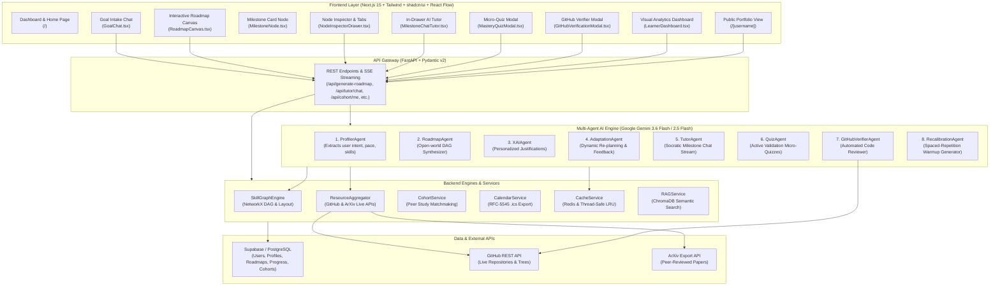
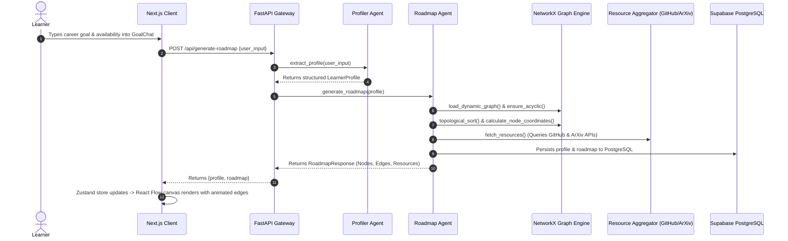

# AI Pathfinder: Complete System Components & Features Inventory

This document provides an exhaustive, component-by-component catalog of the entire **AI Pathfinder** ecosystem. It details every frontend interface, backend service, multi-agent AI module, database entity, and external API integration.

---

## 1. System Architecture Diagram

---

## 2. Frontend Components & Features Inventory

### 2.1 Pages & Application Shell
| Component / File | Route | Description & Key Features |
| :--- | :--- | :--- |
| **Main Application Page** `src/app/page.tsx` | `/` | • Dynamic conditional layout: Centers the conversational goal intake when no roadmap exists; seamlessly transitions to the full dashboard, canvas, and side drawer when active. • Global authentication verification and sign-out handler. • Real-time state hydration from Supabase backend. |
| **Public Portfolio Page** `src/app/[username]/page.tsx` | `/[username]` | • Shareable public URL for learners to showcase their verified learning journey. • Generates dynamic server-side OpenGraph and Twitter metadata cards for social previews. • Embedded read-only React Flow canvas showing completed and in-progress milestones. |
| **Login Page** `src/app/login/page.tsx` | `/login` | • Supabase authentication login interface with email/password credentials. • JWT session management and automatic redirect to active learning dashboard upon authentication. |
| **Signup Page** `src/app/signup/page.tsx` | `/signup` | • Account registration interface that initializes user profiles and ties into public profile creation triggers. |
| **Root Layout** `src/app/layout.tsx` | Global | • Global dark-mode glassmorphism styling, font configuration, and responsive layout constraints. |
| **Next.js Middleware** `src/middleware.ts` | Global | • Protects authenticated routes and manages Supabase session cookie refreshes. |

---

### 2.2 Conversational Goal Intake
| Component / File | Key Features & Capabilities |
| :--- | :--- |
| **GoalChat** `src/components/chat/GoalChat.tsx` | • **Natural Language Intake**: Accepts free-form career goals, existing skill descriptions, and weekly time commitments. • **Quick Suggestions**: Clickable prompt templates (e.g., AI Engineering, Full Stack Web, Data Science Transition). • **Visual Synthesis Loader**: Animated glowing progress spinner indicating multi-agent curriculum generation. |

---

### 2.3 Interactive Graph Canvas & Visualization
| Component / File | Key Features & Capabilities |
| :--- | :--- |
| **RoadmapCanvas** `src/components/roadmap/RoadmapCanvas.tsx` | • **Zoomable & Pannable DAG Canvas**: Powered by `@xyflow/react` (React Flow v12). • **Custom Node & Edge Mapping**: Synchronizes global state with interactive node positions. • **Interactive Selection**: Clicking a milestone opens the Node Inspector Drawer; clicking canvas background deselects. • **Read-Only Mode**: Supports embedding inside public portfolio pages with interactive drag and zoom while locking edit controls. |
| **MilestoneNode** `src/components/roadmap/MilestoneNode.tsx` | • **Status Badges**: Dynamic indicators for `locked`, `available`, `in_progress`, and `completed` states. • **Milestone Metadata**: Displays estimated completion weeks, difficulty tier, and acquired skill tags. • **Selection Feedback**: Visual ring glow when the milestone is selected. |
| **PrerequisiteEdge** `src/components/roadmap/PrerequisiteEdge.tsx` | • **Curved Bezier Connections**: Smooth curves routing prerequisite relationships between milestone nodes. • **Animated Pulse**: Glowing animation representing active learning tracks. |

---

### 2.4 Milestone Inspector, AI Tutor & Validation
| Component / File | Key Features & Capabilities |
| :--- | :--- |
| **NodeInspectorDrawer** `src/components/roadmap/NodeInspectorDrawer.tsx` | • **Slide-Over Sheet**: Slides in from the right to display milestone details. • **Explainable AI (XAI) Card**: Deep personalized justification answering *"Why was this recommended for you?"*. • **Curated Resource Cards**: Direct links to primary and alternative learning resources (official documentation, live top-starred GitHub repos, peer-reviewed ArXiv papers, and video courses) with ratings and duration. • **Tabbed Interface**: Quick toggle between Overview and In-Drawer AI Tutor. |
| **MilestoneChatTutor** `src/components/roadmap/MilestoneChatTutor.tsx` | • **Context-Aware Socratic Tutor**: Bounded strictly to the selected milestone and the user's career goal. • **Real-Time Token Streaming**: Consumes Server-Sent Events (SSE) from the FastAPI backend for instant response streaming. • **Auto-Scrolling Chat History**: Maintains chat context across student inquiries. |
| **MasteryQuizModal** `src/components/roadmap/MasteryQuizModal.tsx` | • **Active Knowledge Validation**: Generates 3 applied multiple-choice questions tailored to the milestone. • **Instant Grading**: Evaluates answers, provides detailed rationale for correct and incorrect choices, and automatically completes the node upon passing (score $\ge 66\%$). |
| **GitHubVerificationModal** `src/components/roadmap/GitHubVerificationModal.tsx` | • **Live Project Verification**: Learner inputs a public GitHub repository link. • **Senior Engineer Code Review**: Inspects file trees and README via GitHub REST API, producing structured strengths, weaknesses, and a formal pass/fail decision. |
| **AdaptationControls** `src/components/roadmap/AdaptationControls.tsx` | • **Quick Action Bar**: "Mark as Mastered" (Quiz), "Verify Repo" (GitHub), and "Need More Practice?" buttons. • **Adaptive Feedback Input**: Allows learners to describe learning hurdles; triggers the AdaptationAgent to re-balance the curriculum. |

---

### 2.5 Learner Dashboard & Visual Analytics
| Component / File | Key Features & Capabilities |
| :--- | :--- |
| **LearnerDashboard** `src/components/dashboard/LearnerDashboard.tsx` | • **Summary Metrics**: High-level counter cards for total estimated weeks, total study hours, milestones completed/total, and learning pace. • **Dynamic Phase Radar Chart**: Built with Recharts. Dynamically calculates and renders skill proficiency across the active roadmap's phases for any domain. • **Progress Burn-Up Bar**: Real-time percentage completion tracking. • **Smart Calendar Sync**: Downloads an RFC-5545 `.ics` file with study reminders mapped to weekdays. • **Spaced Repetition Recalibration**: Inserts AI-powered warmup refresher milestones when learners return after a break. • **Peer Study Cohort Widget**: Displays peer group rankings, usernames, and live milestone progress. |

---

### 2.6 State Management & Client Infrastructure
| Module / File | Key Features & Capabilities |
| :--- | :--- |
| **Zustand Roadmap Store** `src/store/useRoadmapStore.ts` | • Central reactive state for `profile`, `roadmap`, `activeNodeId`, `isLoading`, and `error`. • Actions: `initializeState()`, `submitGoal()`, `completeNode()`, `submitFeedback()`, `recalibrateRoadmap()`, `syncCalendar()`, `setActiveNode()`, `reset()`. |
| **API Client** `src/lib/api.ts` | • Type-safe HTTP client wrapping all backend endpoints with automatic Supabase JWT Bearer header injection. |
| **Supabase Client Layer** `src/lib/supabase/` | • `client.ts`: Browser Supabase client. • `server.ts`: Server Component client supporting Next.js 15 asynchronous cookie handling. • `middleware.ts`: Session refresh handler. |

---

## 3. Backend Services & Multi-Agent Architecture

### 3.1 Multi-Agent AI System (`backend/agents/`)
| Agent Module | Description & Technical Implementation |
| :--- | :--- |
| **ProfilerAgent** `profiler_agent.py` | • **Natural Language Extraction**: Uses Google Gemini (`gemini-3.6-flash` / `gemini-2.5-flash`) to parse unconstrained user text into a validated `LearnerProfile` (target role, skill map, hours/week, learning pace). • Enforces strict Pydantic JSON schema output. |
| **RoadmapAgent** `roadmap_agent.py` | • **Open-World Dynamic Synthesizer**: Generates 10–15 milestone skills and prerequisite edges tailored specifically to the learner's background. • Loads the graph into NetworkX, eliminates circular dependencies (`ensure_acyclic`), topologically sorts learning order, groups milestones into topological phases, fetches live multi-modal learning resources, and computes 2D React Flow layout coordinates. |
| **XAIAgent** `xai_agent.py` | • **Explainable AI Engine**: Synthesizes 2–3 sentence transparent justifications explaining exactly why a node is essential for the learner's target role, identifying direct prerequisites and skills unlocked next. • Features 24-hour MD5 key caching via `CacheService`. |
| **AdaptationAgent** `adaptation_agent.py` | • **Dynamic Path Re-balancer**: Updates learner profiles when milestones are mastered or when feedback is submitted. • Ingests feedback (e.g. *"This is too hard"* or *"I want to focus on DevOps instead"*), recalibrates the target role if necessary, records milestone completions in the database, and re-synthesizes the downstream roadmap. |
| **TutorAgent** `tutor_agent.py` | • **Socratic AI Mentor**: Streams conversational responses token-by-token using Gemini's `generate_content_stream`. • Injects milestone context, learner goals, and skill level into the system prompt to guide learners through conceptual hurdles without giving away direct solutions. |
| **QuizAgent** `quiz_agent.py` | • **Active Validation Generator**: Generates 3 applied multiple-choice questions tailored to the active milestone's difficulty and description. • Enforces structured JSON output containing 4 options, 0-indexed correct answers, and conceptual explanations. |
| **GitHubVerifierAgent** `github_verifier_agent.py` | • **Automated Capstone Reviewer**: Queries the GitHub REST API using `httpx.AsyncClient` to fetch repository file trees (`/git/trees/HEAD`) and decodes base64 `README.md` contents. • Analyzes project architecture against milestone requirements and outputs structured evaluation scores, strengths, weaknesses, and a pass/fail verdict. |
| **RecalibrationAgent** `recalibration_agent.py` | • **Spaced Retrieval Engine**: Mitigates the Ebbinghaus forgetting curve by inserting a targeted "Warmup Review" milestone directly before the learner's active node. • Uses Gemini to generate a 15-minute review brief and queries `ResourceAggregator` for live prerequisite cheat sheets and documentation. |

---

### 3.2 Backend Engines & Core Services (`backend/services/`)
| Service Module | Description & Technical Implementation |
| :--- | :--- |
| **SkillGraphEngine** `graph_engine.py` | • **NetworkX Prerequisite DAG Engine**: Constructs directed graphs, detects cycles, and automatically severs circular dependencies. • Computes topological sort orders and generational depth layers. • Calculates normalized $(x, y)$ coordinate grids for React Flow rendering. |
| **ResourceAggregator** `resource_aggregator.py` | • **Multi-Modal Live Resource Collector**: Connects to the **GitHub Search API** (`api.github.com/search/repositories`) for real top-starred open-source projects, the **ArXiv Export API** (`export.arxiv.org/api/query`) for peer-reviewed research papers, and a verified registry for official developer documentation (Python, FastAPI, React, Next.js, PyTorch, Docker, Kubernetes, AWS, etc.). • Caches fetched resources with 24-hour TTL. |
| **CohortService** `cohort_service.py` | • **Peer Study Matchmaking**: Automatically assigns learners to active study cohorts targeting the same career role (capacity: 8 learners). • Computes live completion percentages by querying `milestone_progress` and `roadmaps` for each cohort peer. |
| **CalendarService** `calendar_service.py` | • **RFC-5545 iCalendar Generator**: Converts roadmap milestone timelines and weekly commitments into recurring `.ics` study focus events compatible with Google Calendar, Outlook, and Apple Calendar. |
| **CacheService** `cache_service.py` | • **Multi-Tier Caching Layer**: Connects to Redis clusters when `REDIS_URL` is set, with an automatic fallback to a thread-safe, memory-bounded LRU in-memory cache with TTL eviction. |
| **RAGService** `rag_service.py` | • **Vector Embedding Store**: Manages ChromaDB collections with `all-MiniLM-L6-v2` embeddings for catalog lookups. |
| **LLMClient** `llm_client.py` | • **Unified Gemini Client**: Uses the official `google-genai` SDK with `gemini-3.6-flash`. • Enforces structured JSON schemas, manages chat streams, and provides exponential backoff retries via `tenacity`. |

---

## 4. API Endpoints Reference (`backend/api/routes.py`)

| Method | Endpoint | Description | Auth Required |
| :---: | :--- | :--- | :---: |
| `GET` | `/` | Base API health check & status. | ❌ |
| `GET` | `/api/active-roadmap` | Retrieves the authenticated user's active roadmap and profile. | ✅ |
| `POST` | `/api/generate-roadmap` | Synthesizes a new personalized roadmap from conversational user input. | ✅ |
| `POST` | `/api/explain-node` | Generates a personalized XAI explanation for a specific milestone. | ✅ |
| `POST` | `/api/adapt-roadmap` | Re-evaluates and adapts the roadmap based on feedback or milestone completion. | ✅ |
| `POST` | `/api/tutor/chat` | Opens a real-time SSE stream with the contextual Socratic AI tutor. | ✅ |
| `POST` | `/api/verify/quiz/generate` | Generates a 3-question active validation micro-quiz for a milestone. | ✅ |
| `POST` | `/api/verify/github` | Inspects a public GitHub repository and returns a structured capstone review. | ✅ |
| `POST` | `/api/calendar/sync` | Generates and downloads a `.ics` iCalendar file for the user's roadmap. | ✅ |
| `POST` | `/api/roadmap/recalibrate` | Injects an AI-synthesized warmup refresher milestone into the roadmap DAG. | ✅ |
| `GET` | `/api/public/roadmap/{username}` | Fetches public portfolio roadmap data for social sharing and OpenGraph previews. | ❌ |
| `GET` | `/api/cohort/me` | Retrieves the user's current study cohort and peer milestone progress. | ✅ |
| `POST` | `/api/cohort/match` | Re-matches the user into a new study cohort based on target role. | ✅ |

---

## 5. Database Schema & Data Models (`backend/db/schema.sql`)

| Table Name | Primary Key | Key Columns | Purpose |
| :--- | :--- | :--- | :--- |
| `users` | `id` (UUID) | `email`, `username`, `created_at` | Stores public user accounts synchronized with Supabase Auth. |
| `learner_profiles` | `user_id` (UUID) | `target_role`, `weekly_hours`, `learning_pace`, `skills` (JSONB) | Stores the learner's career target, time availability, and skill levels. |
| `roadmaps` | `id` (UUID) | `user_id`, `title`, `target_role`, `total_estimated_weeks`, `total_hours`, `graph_payload` (JSONB), `is_active`, `is_public` | Stores generated DAG nodes, edges, milestones, and metadata. |
| `milestone_progress` | `id` (UUID) | `roadmap_id`, `node_id`, `status`, `completed_at` | Tracks the completion status (`available`, `locked`, `in_progress`, `completed`) of each node. |
| `cohorts` | `id` (UUID) | `topic`, `target_role`, `max_members`, `created_at` | Manages peer study groups organized by domain/career track. |
| `cohort_members` | `id` (UUID) | `cohort_id`, `user_id`, `joined_at` | Maps learners to study cohorts with capacity constraints. |

---

## 6. Test Suites & Verification Status

| Test Suite File | Tested Modules | Verification Status |
| :--- | :--- | :---: |
| `backend/tests/test_api.py` | API Scaffolding & Route Auth | 🟢 PASSED |
| `backend/tests/test_cohort_service.py` | Cohort Matchmaking & Peer Progress | 🟢 PASSED |
| `backend/tests/test_graph_engine.py` | NetworkX DAG, Cycle Detection & Coordinates | 🟢 PASSED |
| `backend/tests/test_llm_client.py` | Google GenAI SDK & Structured Output | 🟢 PASSED |
| `backend/tests/test_profiler_agent.py` | Natural Language Profiling Agent | 🟢 PASSED |
| `backend/tests/test_rag_service.py` | ChromaDB Vector Search & Filtering | 🟢 PASSED |
| `backend/tests/test_recalibration_agent.py` | Spaced Repetition Refresher Synthesis | 🟢 PASSED |
| `backend/tests/test_resource_aggregator.py` | GitHub Search API & ArXiv API Integration | 🟢 PASSED |
| `backend/tests/test_roadmap_agent.py` | Open-World DAG Synthesis & Layout Engine | 🟢 PASSED |
| `backend/tests/test_schemas.py` | Pydantic v2 Schema Validations | 🟢 PASSED |
| `backend/tests/test_xai_agent.py` | Explainability (XAI) Agent & Caching | 🟢 PASSED |
| `frontend/tsc` | TypeScript Strict Mode Compilation | 🟢 PASSED (0 errors) |
| `frontend/build` | Next.js Production Turbopack Build | 🟢 PASSED (0 errors) |

---

## 7. End-to-End Application Workflows & App Flows

This section documents the exact step-by-step execution flows, data transformations, and agent handoffs across every user interaction in the application.

---

### Flow 1: Conversational Onboarding to Dynamic Graph Synthesis
1. **User Action**: The learner enters a natural language goal into [`GoalChat.tsx`](file:///e:/Antigravity_workspace/Ai_pathfinder/frontend/src/components/chat/GoalChat.tsx) (e.g., *"I want to become an AI Engineer with 10 hours a week"*).
2. **API Dispatch**: `submitGoal()` in Zustand dispatches `POST /api/generate-roadmap`.
3. **Profiling**: [`ProfilerAgent`](file:///e:/Antigravity_workspace/Ai_pathfinder/backend/agents/profiler_agent.py) calls Gemini with structured output mode to extract a `LearnerProfile` (`target_role`, `weekly_hours`, `learning_pace`, `skills`).
4. **Curriculum Synthesis**: [`RoadmapAgent`](file:///e:/Antigravity_workspace/Ai_pathfinder/backend/agents/roadmap_agent.py) prompts Gemini to generate an open-world Directed Acyclic Graph of 10–15 milestones.
5. **Graph Verification & Sorting**: [`SkillGraphEngine`](file:///e:/Antigravity_workspace/Ai_pathfinder/backend/services/graph_engine.py) loads the nodes/edges, resolves circular dependencies via cycle breaking, computes topological generations (Phases), and computes React Flow $(x, y)$ coordinates.
6. **Multi-Modal Resource Collection**: [`ResourceAggregator`](file:///e:/Antigravity_workspace/Ai_pathfinder/backend/services/resource_aggregator.py) queries live GitHub repositories, ArXiv research papers, and official documentation for each milestone.
7. **Database Persistence**: The generated roadmap and profile are saved to Supabase (`roadmaps` and `learner_profiles` tables).
8. **UI Transition**: The Next.js client transitions from the centered intake view to the interactive [`RoadmapCanvas`](file:///e:/Antigravity_workspace/Ai_pathfinder/frontend/src/components/roadmap/RoadmapCanvas.tsx) with custom nodes, animated prerequisite edges, and the analytics dashboard.

---

### Flow 2: Milestone Inspection & Explainable AI (XAI) Justification
1. **User Action**: Learner clicks on any milestone card on the React Flow canvas.
2. **Drawer Activation**: [`NodeInspectorDrawer.tsx`](file:///e:/Antigravity_workspace/Ai_pathfinder/frontend/src/components/roadmap/NodeInspectorDrawer.tsx) slides open from the right.
3. **Lazy-Loaded Rationale**: The client calls `POST /api/explain-node` passing the active `node_id`, `profile`, and `roadmap`.
4. **XAI Agent Execution**: [`XAIAgent`](file:///e:/Antigravity_workspace/Ai_pathfinder/backend/agents/xai_agent.py) evaluates direct incoming edges (prerequisites) and outgoing edges (skills unlocked next). It checks the MD5 cache key in [`CacheService`](file:///e:/Antigravity_workspace/Ai_pathfinder/backend/services/cache_service.py) or prompts Gemini to generate a succinct 2–3 sentence personalized justification.
5. **Resource Exploration**: The drawer renders direct links to official documentation, top-starred GitHub repositories (with star counts), ArXiv papers, and video courses.

---

### Flow 3: Real-Time Socratic AI Tutor Chat Streaming
1. **User Action**: In the Node Inspector Drawer, the learner switches to the "AI Tutor" tab and enters a conceptual question in [`MilestoneChatTutor.tsx`](file:///e:/Antigravity_workspace/Ai_pathfinder/frontend/src/components/roadmap/MilestoneChatTutor.tsx).
2. **Streaming Request**: Client dispatches `POST /api/tutor/chat` with conversation history and milestone metadata.
3. **Context Binding**: [`TutorAgent`](file:///e:/Antigravity_workspace/Ai_pathfinder/backend/agents/tutor_agent.py) injects the milestone title, phase, acquired skills, and learner goals into a Socratic mentor prompt.
4. **SSE Token Stream**: The backend returns a `StreamingResponse` using Gemini's `generate_content_stream`.
5. **Client Stream Consumption**: The frontend reads chunks via `response.body.getReader()`, dynamically appending tokens in real time while auto-scrolling to the bottom of the chat view.

---

### Flow 4: Active Validation Micro-Quiz & Mastery Completion
1. **User Action**: Learner clicks "Mark as Mastered" in [`AdaptationControls.tsx`](file:///e:/Antigravity_workspace/Ai_pathfinder/frontend/src/components/roadmap/AdaptationControls.tsx).
2. **Modal Generation**: [`MasteryQuizModal.tsx`](file:///e:/Antigravity_workspace/Ai_pathfinder/frontend/src/components/roadmap/MasteryQuizModal.tsx) opens and calls `POST /api/verify/quiz/generate`.
3. **Quiz Synthesis**: [`QuizAgent`](file:///e:/Antigravity_workspace/Ai_pathfinder/backend/agents/quiz_agent.py) prompts Gemini to generate 3 applied multiple-choice questions with 4 options each, answer index, and conceptual explanations.
4. **Learner Evaluation**: The user selects answers and submits the quiz.
5. **Automatic Mastery Unlock**: If the learner scores $\ge 66\%$ (2/3 correct), the client automatically calls `POST /api/adapt-roadmap` to mark the node as `completed`.
6. **Progress Update**: Supabase records completion in `milestone_progress`, unlocks downstream nodes (setting them to `available`), updates the Phase Radar Chart, and recalculates cohort progress.

---

### Flow 5: Automated GitHub Capstone Project Verification
1. **User Action**: Learner clicks "Verify Repo" and inputs a public GitHub repository link into [`GitHubVerificationModal.tsx`](file:///e:/Antigravity_workspace/Ai_pathfinder/frontend/src/components/roadmap/GitHubVerificationModal.tsx).
2. **API Dispatch**: Client sends `POST /api/verify/github` with `repo_url` and `node_id`.
3. **Live Codebase Inspection**: [`GitHubVerifierAgent`](file:///e:/Antigravity_workspace/Ai_pathfinder/backend/agents/github_verifier_agent.py) uses `httpx.AsyncClient` to query the GitHub REST API:
   - Fetches repository tree: `GET https://api.github.com/repos/{owner}/{repo}/git/trees/HEAD?recursive=1`
   - Fetches and decodes README: `GET https://api.github.com/repos/{owner}/{repo}/readme`
4. **Senior Engineer Code Review**: Gemini compares the repository's file structure and README implementation against the milestone's practical project requirements.
5. **Structured Verdict**: Returns a structured report with strengths, weaknesses, feedback summary, and an `approved: true/false` decision. If approved, the milestone is marked as mastered.

---

### Flow 6: Dynamic Adaptation & Feedback Re-balancing
1. **User Action**: Learner clicks "Need More Practice?" or submits feedback regarding learning difficulty or interest shifts.
2. **API Dispatch**: Client calls `POST /api/adapt-roadmap`.
3. **Feedback Interpretation**: [`AdaptationAgent`](file:///e:/Antigravity_workspace/Ai_pathfinder/backend/agents/adaptation_agent.py) analyzes the feedback to determine if the target role needs refinement.
4. **Curriculum Regeneration**: Updates the user profile with newly acquired skills, prompts [`RoadmapAgent`](file:///e:/Antigravity_workspace/Ai_pathfinder/backend/agents/roadmap_agent.py) to re-synthesize downstream milestones excluding completed skills, and persists the updated graph to PostgreSQL.
5. **UI Smooth Update**: The React Flow canvas refreshes with smooth transitions, highlighting newly unlocked or re-routed milestones.

---

### Flow 7: Smart Calendar Synchronization (.ics Export)
1. **User Action**: Learner clicks "Add to Calendar" on the [`LearnerDashboard`](file:///e:/Antigravity_workspace/Ai_pathfinder/frontend/src/components/dashboard/LearnerDashboard.tsx).
2. **API Request**: Dispatches `POST /api/calendar/sync` with active roadmap and weekly hours.
3. **ICS Construction**: [`CalendarService`](file:///e:/Antigravity_workspace/Ai_pathfinder/backend/services/calendar_service.py) calculates milestone timelines, divides estimated study hours across weekdays, and constructs standard RFC-5545 `BEGIN:VCALENDAR` payloads with recurring `VEVENT` items.
4. **Browser Download**: The browser receives `text/calendar` with `Content-Disposition: attachment; filename=roadmap_<id>.ics` and automatically triggers file download for import into Google Calendar, Apple Calendar, or Outlook.

---

### Flow 8: Spaced Repetition Recalibration Flow
1. **User Action**: Returning learners click "Recalibrate" on the dashboard.
2. **API Request**: Dispatches `POST /api/roadmap/recalibrate`.
3. **Refresher Synthesis**: [`RecalibrationAgent`](file:///e:/Antigravity_workspace/Ai_pathfinder/backend/agents/recalibration_agent.py) locates the active/available milestone, queries its prerequisite topics, and calls Gemini to synthesize a 15-minute warmup refresher module.
4. **Live Review Resources**: Queries [`ResourceAggregator`](file:///e:/Antigravity_workspace/Ai_pathfinder/backend/services/resource_aggregator.py) for live prerequisite cheat sheets and documentation.
5. **DAG Edge Rewiring**: Injects a `refresher_<id>` node directly upstream of the active node, reroutes incoming edges to the refresher, connects the refresher to the active node, and locks the active node until the refresher is completed.

---

### Flow 9: Social Peer Cohort Matchmaking & Live Progress
1. **User Action**: Learner opens the dashboard or calls "Match New Cohort".
2. **Cohort Query**: [`LearnerDashboard.tsx`](file:///e:/Antigravity_workspace/Ai_pathfinder/frontend/src/components/dashboard/LearnerDashboard.tsx) requests `GET /api/cohort/me`.
3. **Automated Matchmaking**: [`CohortService`](file:///e:/Antigravity_workspace/Ai_pathfinder/backend/services/cohort_service.py) checks if the user is in a cohort; if not, queries `cohorts` for an open group matching `target_role` (< 8 members) or creates a new cohort automatically.
4. **Live Progress Aggregation**: Queries `cohort_members` join `users` join `milestone_progress` to calculate real-time completion percentages for each peer in the group.
5. **Leaderboard Rendering**: Renders the peer cohort card on the dashboard showing ranked progress bars and avatars.

---

### Flow 10: Public Portfolio & OpenGraph Social Sharing
1. **External Request**: A visitor opens `https://<domain>/[username]`.
2. **Dynamic Metadata Generation**: Next.js App Router executes `generateMetadata` in [`src/app/[username]/page.tsx`](file:///e:/Antigravity_workspace/Ai_pathfinder/frontend/src/app/%5Busername%5D/page.tsx), querying `GET /api/public/roadmap/{username}`.
3. **OpenGraph Injection**: Server generates dynamic page titles, descriptions, and Twitter/OG cards summarizing the learner's journey.
4. **Read-Only Canvas Rendering**: Server renders a read-only instance of [`RoadmapCanvas`](file:///e:/Antigravity_workspace/Ai_pathfinder/frontend/src/components/roadmap/RoadmapCanvas.tsx) with interactive zoom and drag, while locking editing controls and side-drawer modifications for public visitors.

